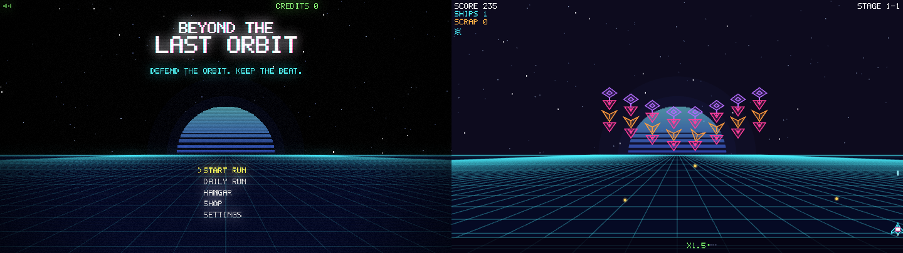
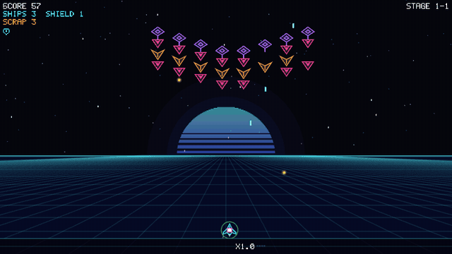

# Beyond the Last Orbit

<p align="center">
  
</p>

Neon arcade roguelite shooter with a procedurally synthesized heavy-metal soundtrack. Enemy formations sway on the beat — fire in rhythm to build your multiplier, graze bullets, draft upgrades and push through three worlds of branching stages.

<p align="center">
  
</p>

## Features

- **Rhythm combat** — beat stages grade every shot PERFECT / GOOD / OFF; on-beat play builds up to x8
- **Roguelite runs** — 3 worlds × 5 stages, bosses, a branching node map, upgrade drafts with synergies and curses
- **Daily Run** — one shared seed per day with its own global leaderboard
- **Plays anywhere** — keyboard or touch/tilt, any aspect ratio, installable and offline-capable

## Quick start

```bash
npm install
npm run dev   # http://localhost:5173
npm test
npm run build
```

**Controls:** Arrows/WASD to move, Space to fire, P/Esc to pause. On touch: drag to move, tap to fire.

## Docs

- [Gameplay](docs/gameplay.md) — run structure, scoring, beat stages, upgrades, full controls
- [Development](docs/development.md) — scripts, deployment, Supabase leaderboard, code layout

## Credits

Drums: [DrumGizmo MuldjordKit](https://github.com/sfzinstruments/DrumGizmo.MuldjordKit) (CC BY 4.0) · Guitar DI: [FreePats FSBS](https://github.com/freepats/electric-guitar-FSBS-direct) (CC0) · Cabinet IRs: [Jester's Brutal Pack](https://www.jester-dyne-productions.com/brutal-ir-pack/) (CC0). Details in [`public/audio/CREDITS.md`](public/audio/CREDITS.md).
